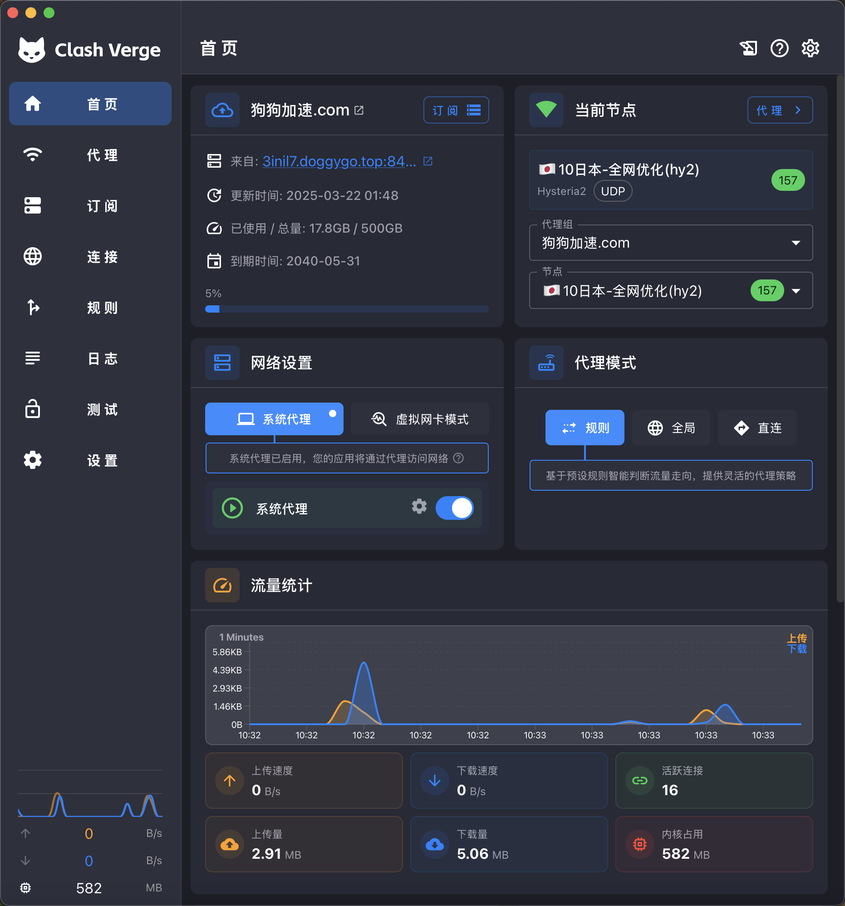
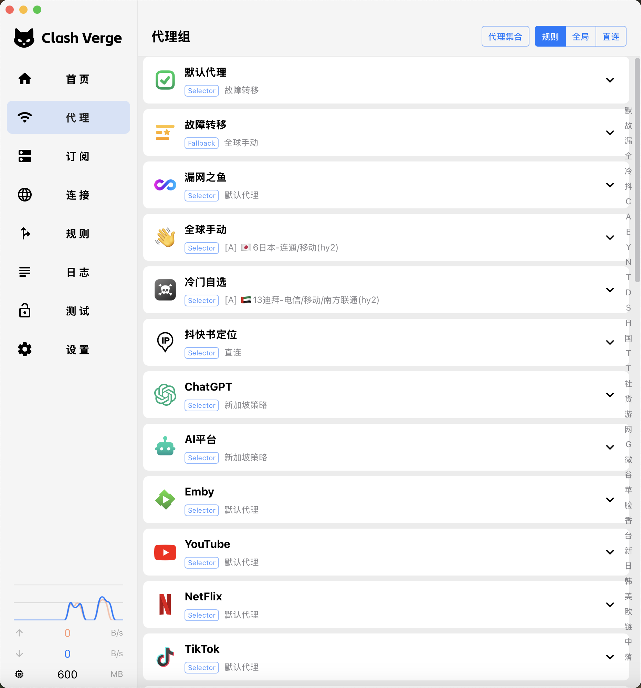

<h1 align="center">
  
  <br>
  Continuation of <a href="https://github.com/zzzgydi/clash-verge">Clash Verge</a>
  <br>
</h1>

<h3 align="center">
A Clash Meta GUI based on <a href="https://github.com/tauri-apps/tauri">Tauri</a>.
</h3>

<p align="center">
  Languages:
  <a href="./README.md">简体中文</a> ·
  <a href="./docs/README_en.md">English</a> ·
  <a href="./docs/README_es.md">Español</a> ·
  <a href="./docs/README_ru.md">Русский</a> ·
  <a href="./docs/README_ja.md">日本語</a> ·
  <a href="./docs/README_ko.md">한국어</a> ·
  <a href="./docs/README_fa.md">فارسی</a>
</p>

## Preview

| Dark                             | Light                             |
| -------------------------------- | --------------------------------- |
|  |  |

## Install

请到发布页面下载对应的安装包：[Release page](https://github.com/clash-verge-rev/clash-verge-rev/releases)<br>
Go to the [Release page](https://github.com/clash-verge-rev/clash-verge-rev/releases) to download the corresponding installation package<br>
Supports Windows (x64/x86), Linux (x64/arm64) and macOS 11+ (intel/apple).

#### 我应当怎样选择发行版

| 版本        | 特征                                     | 链接                                                                                   |
| :---------- | :--------------------------------------- | :------------------------------------------------------------------------------------- |
| Stable      | 正式版，高可靠性，适合日常使用。         | [Release](https://github.com/clash-verge-rev/clash-verge-rev/releases)                 |
| Alpha(废弃) | 测试发布流程。                           | [Alpha](https://github.com/clash-verge-rev/clash-verge-rev/releases/tag/alpha)         |
| AutoBuild   | 滚动更新版，适合测试反馈，可能存在缺陷。 | [AutoBuild](https://github.com/clash-verge-rev/clash-verge-rev/releases/tag/autobuild) |

#### 安装说明和常见问题，请到 [文档页](https://clash-verge-rev.github.io/) 查看

### TG 频道: [@clash_verge_rev](https://t.me/clash_verge_re)

---

## Promotion

### 🤖 [GPTKefu —— 与 Crisp 深度整合的 AI 智能客服平台](https://gptkefu.com)

- 🧠 深度理解完整对话上下文 + 图片识别，自动给出专业、精准的回复，告别机械式客服。
- ♾️ **不限回答数量**，无额度焦虑，区别于其他按条计费的 AI 客服产品。
- 💬 售前咨询、售后服务、复杂问题解答，全场景轻松覆盖，真实用户案例已验证效果。
- ⚡ 3 分钟极速接入，零门槛上手，即刻提升客服效率与客户满意度。
- 🎁 高级套餐免费试用 14 天，先体验后付费：👉 [立即试用](https://gptkefu.com)
- 📢 智能客服TG 频道：[@crisp_ai](https://t.me/crisp_ai)

---

## Features

- 基于性能强劲的 Rust 和 Tauri 2 框架
- 内置[Clash.Meta(mihomo)](https://github.com/MetaCubeX/mihomo)内核，并支持切换 `Alpha` 版本内核。
- 简洁美观的用户界面，支持自定义主题颜色、代理组/托盘图标以及 `CSS Injection`。
- 配置文件管理和增强（Merge 和 Script），配置文件语法提示。
- 系统代理和守卫、`TUN(虚拟网卡)` 模式。
- 可视化节点和规则编辑
- WebDav 配置备份和同步

### FAQ

Refer to [Doc FAQ Page](https://clash-verge-rev.github.io/faq/windows.html)

### Donation

[捐助Clash Verge Rev的开发](https://github.com/sponsors/clash-verge-rev)

## Development

See [CONTRIBUTING.md](./CONTRIBUTING.md) for more details.

### Build and verification policy

- Full compilation and packaging must run in GitHub Actions. Local machines are only used for type checks, lint, unit tests, `git diff --check`, and optional development preview.
- For changes that are not ready to publish, push an isolated branch, manually run `Frontend Check` and `Clippy Lint`, then use `Development Test` (`.github/workflows/dev.yml`) for full cross-platform compilation and packaging against that branch. Do not change the version, create a tag/Release, or update Dufs/updater metadata merely to validate a build.
- A workflow artifact is a temporary build result, not a published client. Publishing remains a separate, explicitly authorized step.
- The release workflow is tag-only. Do not create a `v*` tag unless a new version has been approved.

### Managed client heartbeat

- While the core is running, the client reports its latest presence about every 120–140 seconds; per-cycle jitter spreads requests across devices while remaining inside the server's five-minute online window even if one report is missed.
- A failed report leaves only the latest desired state in local storage. The next scheduled report or the browser `online` event retries it; historical heartbeats are never replayed in bulk.
- Managed traffic uses a persisted cumulative idempotency counter. The latest observed totals survive an app crash and are retried once per minute without replaying already accepted bytes.
- Usage and device counts are hidden by default and can only be exposed by the server administrator; hiding them never disables accounting or limit enforcement.
- macOS builds must not use `Array.prototype.at()` in runtime frontend code because older Intel macOS WebKit versions do not provide it.

To run the development server, execute the following commands after all prerequisites for **Tauri** are installed:

```shell
pnpm i
pnpm run prebuild
pnpm dev
```

## Contributions

Issue and PR welcome!

## Acknowledgement

Clash Verge rev was based on or inspired by these projects and so on:

- [zzzgydi/clash-verge](https://github.com/zzzgydi/clash-verge): A Clash GUI based on tauri. Supports Windows, macOS and Linux.
- [tauri-apps/tauri](https://github.com/tauri-apps/tauri): Build smaller, faster, and more secure desktop applications with a web frontend.
- [Dreamacro/clash](https://github.com/Dreamacro/clash): A rule-based tunnel in Go.
- [MetaCubeX/mihomo](https://github.com/MetaCubeX/mihomo): A rule-based tunnel in Go.
- [Fndroid/clash_for_windows_pkg](https://github.com/Fndroid/clash_for_windows_pkg): A Windows/macOS GUI based on Clash.
- [vitejs/vite](https://github.com/vitejs/vite): Next generation frontend tooling. It's fast!

## 神仙云发布与分发流程（PC 桌面端）

> 每次更新提交、编译、发布都要遵循以下流程。安卓端流程见
> [shenxianyun-android](https://github.com/abxian/shenxianyun-android) 的 README。

### 一、改完代码后必须先升版本号

桌面端版本号有 **4 处必须同步修改**，否则 Release Action 的「版本一致性校验」会失败：

| 文件 | 字段 |
| --- | --- |
| `package.json` | `"version"` |
| `src-tauri/tauri.conf.json` | `"version"` |
| `src-tauri/Cargo.toml` | `version`（`[package]`） |
| `Cargo.lock` | `name = "clash-verge"` 对应的 `version` |

四处版本号必须完全一致（例如 `2.5.12`）。

### 二、提交并触发公开仓库 Action 编译

Release Build（`.github/workflows/release.yml`）**只由 `v*.*.*` 形式的 git tag 触发**，
且会校验：① tag 所在 commit 必须在 `origin/main` 上；② tag 版本号必须与 `package.json` 一致。

```bash
# 在 main 分支上提交
git add -A
git commit -m "feat: xxx (v2.5.12)"
git push origin main

# 打与版本号一致的 tag 并推送，触发 Release Build
git tag v2.5.12
git push origin v2.5.12
```

Action 会在 Windows / macOS / Linux / ARM 全平台编译（约 30~40 分钟），
并把安装包上传到本仓库的 GitHub Release **`v<版本号>`**（标题 `Clash Verge Rev v<版本号>`）。

- 桌面更新签名用 **Tauri updater 私钥**，存放在私有仓库
  [`abxian/shenxianyun-keys`](https://github.com/abxian/shenxianyun-keys)：
  `shenxianyun-updater.key` / `shenxianyun-updater.key.pub` / `updater-key-password.txt`，
  对应 CI secrets `TAURI_PRIVATE_KEY` / `TAURI_KEY_PASSWORD`。**切勿泄露或提交进公开仓库。**

### 三、从 GitHub Release 下载安装包

Action 跑完后到本仓库 Release `v<版本号>` 页面下载（`<ver>` 为版本号，如 `2.5.12`）：

| 平台 | Action 产物文件名 |
| --- | --- |
| Windows 64 位（常用） | `Clash.Verge_<ver>_x64-setup.exe` |
| macOS Apple 芯片 | `Clash.Verge_<ver>_aarch64.dmg` |
| macOS Intel 芯片 | `Clash.Verge_<ver>_x64.dmg` |
| Linux deb 64 位 | `Clash.Verge_<ver>_amd64.deb` |
| Linux rpm 64 位 | `Clash.Verge-<ver>-1.x86_64.rpm` |

### 四、重命名后上传到 dufs 分发服务

分发服务器：**<http://114.80.36.225:5011/sxy/>**（dufs，支持 WebDAV PUT）。
下载到的安装包按下表**重命名为固定名称**（用户/后台始终按固定名下载），再用 `curl -T`（PUT）上传：

| 固定分发名 | 来源产物 |
| --- | --- |
| `神仙云.exe` | `Clash.Verge_<ver>_x64-setup.exe` |
| `神仙云.dmg` | `Clash.Verge_<ver>_<arch>.dmg`（按需选 aarch64 / x64） |
| `神仙云.deb` | `Clash.Verge_<ver>_amd64.deb` |
| `神仙云.rpm` | `Clash.Verge-<ver>-1.x86_64.rpm` |

```bash
DUFS=http://114.80.36.225:5011/sxy
# 先把下载的安装包重命名为固定名，再 PUT 上传（覆盖同名文件）
curl -T 神仙云.exe "$DUFS/神仙云.exe"
curl -T 神仙云.dmg "$DUFS/神仙云.dmg"
curl -T 神仙云.deb "$DUFS/神仙云.deb"
curl -T 神仙云.rpm "$DUFS/神仙云.rpm"
# dufs 上传需鉴权：-u shenxianyun:shenxianyun@123（匿名只读）
# curl -u user:pass -T 神仙云.exe "$DUFS/神仙云.exe"
```

> 安卓的 `神仙云.apk` / `shenxianyunall.apk` 由 android 仓库流程产出后上传到同一目录。

### 五、流程速记（每次发布都照做）

1. 改代码 → **同步改 4 处版本号**。
2. `git commit` 到 main → `git push origin main`。
3. 打 `v<版本号>` tag → `git push origin <tag>`，触发 Release Build。
4. 等 Action 跑完 → 到 Release `v<版本号>` 下载安装包。
5. 重命名为 `神仙云.exe/.dmg/.deb/.rpm` → `curl -T` 上传到 dufs。

## License

GPL-3.0 License. See [License here](./LICENSE) for details.


### 2026-11-01 管理请求退路（task317）

规则模式保留国内官网优先，失败才使用固定租户ll.sxnn.de通道；两种模式继续受控主动上报。`src/services/managed-relay.ts`缓存短期grant到原加密managed-auth，不存原token到公开队列。counter的冻结pending/observed_at与累计值一起持久化，202不清pending，仅主站事务成功或relay最终applied清除；同counter/seq不重复计量。订阅实时鉴权请求固定上游，不缓存旧配置，401/403不绕过授权重试。

`src-tauri/src/enhance/management.rs`生成仅127.0.0.1随机端口的mixed入站，`proxy:DIRECT`在Mihomo特殊入站优先级下先于global选择；官网管理请求可经此入口避免TUN全球出口影响，不修改用户mode/选中节点/正常业务规则。端口同进程稳定、随核心配置重新生成，未运行核心时仍尝试原站直连。纯本机隔离真实Mihomo测试：GLOBAL=REJECT时普通mixed失败、管理入站HTTP200。客户端云构建/发布与真机验收另行记录，版本号和正式分发本轮不改。


## 2026-11-01 同一服务的首次提取码导入入口（317补充）

双品牌提取码验证/订阅状态/一次性票据申请和设备交换通过同一ll.sxnn.de固定tenant入口，国内DIRECT仍优先、失败备用；不增加新服务器，不共享客户数据库/密钥。relay1.2固定允许verify/state/ticket/exchange的POST正文和官方target，不需要尚不存在的设备token；原主站继续校验提取码/有效期/设备数/一次性票据和既有限速，不缓存凭据或节点。POST /api/v2/client/{verify,state}分别复用原校验/版本状态语义，避免国外入口路径带明文提取码。消费者与上报最终ACK仍按前阶段原实现。交换410/401/403等业务拒绝不自动走备用再消费；网络超时的不确定结果不假称成功，保留原配置。客户端仅验证分支编译，未改正式版本或分发，等用户通知云构建完成后再查准确新source。


### 神仙云 PC 2.5.53 发布记录

基于已通过前端、三平台 Clippy 与四平台测试打包的共享管理备用修复。本次递增四处应用版本载体并更新发行说明，原服务 IPC 版本及更新签名保持。正式 tag 构建、安装包验签、下载分发与真机验收分别记录；提交正式打包不代表分发完成。


### 更新提醒与手动刷新管理链路（2026-11-01 / task318）

- 主界面在导入前后均保留「检查新版」和可重新展开的玻璃新版提醒，启动检查不会弹出阻塞窗口；签名更新源与官网版本元数据均可发现新版。下载/安装仍沿本品牌、各平台原有流程，元数据本身不代替包签名。
- 有效受管凭据点击更新直接获取后台实时鉴权订阅；不把公共状态探测失败当作无需下载。过期凭据恢复仍保留状态、一次性票据、设备限制和配置验证/回滚，完全断网不能更新。
- 官方管理请求先用核心强制DIRECT入口，再明确绕过系统代理；每条路径包含响应体的超时和取消，核心尚未就绪时也不依赖主页普通代理端口初始化。主备路径均不临时切换全局/规则模式。
- 对话框、提示和通知使用统一半透明玻璃主题，技术错误弹层继续隐藏，简短失败反馈与原有效配置保护保留。
- 新门禁 `scripts/test-management-refresh.mjs` 与原恢复/relay用例在 Frontend Check 一起运行；隔离原生reqwest证明系统死代理下显式绕过可用，隔离Mihomo GLOBAL=REJECT证明专用DIRECT通道可用，不代表真机TUN验收。


### 神仙云 PC 2.5.54 发布记录

基于准确源码已通过前端、三平台 Clippy 和四平台测试打包的玻璃更新提醒与独立管理请求修复。本次仅更新四处版本载体和发行文档，保持原签名、服务 IPC 与各平台安装方式。正式构建、安装包验签、下载分发和真机验收分别记录；提交正式打包不代表分发完成。


### 首页提醒与默认模式（319）

首页仅在发现更高版本时显示玻璃新版提醒和“点击更新”按钮，后台启动检查继续执行；检查中、无新版或检查失败不占用首页空间，设置页保留检查入口。应用进程每次冷启动默认规则模式，运行中可手动切全局；返回首页、刷新订阅与重启核心不会因此重置用户刚选的模式。

手动更新订阅完成后显示可关闭、会自动隐藏的玻璃结果提示；节点没有变化也明确提示更新成功/已是最新，失败保留原订阅且不显示技术堆栈，自动刷新不额外弹出结果。点击后按钮显示更新中。启动模式原生隔离测试 `python3 scripts/test-startup-mode.py` 与反馈事务测试 `node --experimental-strip-types --test scripts/test-subscription-refresh-feedback.mjs` 已接入 Frontend Check；正式新包安装后生效，源码构建提交不等于已发布。
